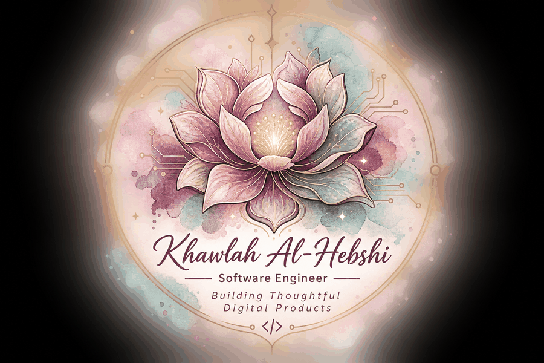

<!-- 🌸 KHAWLAH AL-HEBSHI — Personal Portfolio -->
<div align="center">

  

  <br/>

  

  <br/><br/>

  <a href="https://github.com/khowlah">
    
  </a>
  <a href="https://linkedin.com/in/khawlah-al-hebshi-12046a38a">
    
  </a>
  <a href="https://khowlah.github.io/Myprotofile">
    
  </a>

  <br/><br/>

  
  
  
  

  <br/><br/>

  <i>Designed with curiosity. Built with purpose.</i>
  <br/>
  <sub>✦ Personal Developer Portfolio & Signature — Khawlah Al-Hebshi ✦</sub>

</div>

---

## 🌐 Overview

This repository hosts the source code for **Khawlah Al-Hebshi's Developer Portfolio**, built with **Flutter Web** and deployed via GitHub Pages.

🔗 **Live Portfolio:** [khowlah.github.io/Myprotofile](https://khowlah.github.io/Myprotofile)

The portfolio showcases selected software engineering projects across backend systems (Next.js, Node.js, PostgreSQL/Supabase), cross-platform mobile applications (Flutter), and AI-integrated workflows.

---

## 🛠 Tech Stack

- **Framework:** [Flutter](https://flutter.dev/) (Web)
- **Language:** [Dart](https://dart.dev/)
- **Hosting & Deployment:** GitHub Pages
- **Asset Management:** Responsive media layout for desktop and mobile browsers

---

## 💻 Local Development

To run this portfolio locally on your machine:

```bash
# 1. Clone the repository
git clone https://github.com/khowlah/Myprotofile.git
cd Myprotofile

# 2. Fetch Flutter packages
flutter pub get

# 3. Run on Chrome
flutter run -d chrome
```

---

## 👩‍💻 About Khawlah Al-Hebshi

I'm **Khawlah Al-Hebshi**, a Software Engineering graduate specializing in backend development with Next.js and cross-platform mobile development with Flutter. I bring together software engineering rigor, product thinking, and AI-assisted workflows to build practical digital experiences.

I use AI and vibe coding as tools in the development process, keeping the focus on clear problem-solving, sound architecture, and products that serve real needs.
